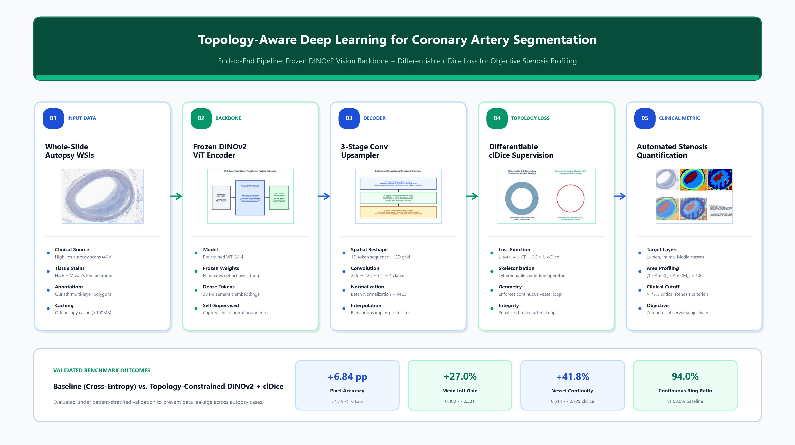
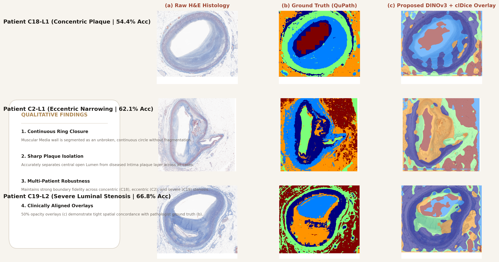

# Topology-Preserving Coronary Artery Segmentation using DINOv2 and Differentiable clDice Loss

[](https://www.python.org/)
[](https://pytorch.org/)
[](https://github.com/facebookresearch/dinov2)
[](LICENSE)
[](https://www.univr.it/)

This repository contains the official codebase and research materials for the Master's Thesis:
> **"Integrating Topological Priors and Self-Supervised Representation Learning for Image Segmentation"**  
> **Author:** Adheena Vinod  
> **Supervisor:** Prof. Francesco Setti  
> **Degree:** Master's Degree in Data Science, Università degli Studi di Verona

---

## 📌 Overview

In forensic pathology, sudden cardiac death investigations rely on measuring **coronary artery stenosis (% luminal narrowing)**. However, traditional manual microscopic tracing suffers from severe **inter-observer subjectivity**, while standard pixel-wise segmentation models (trained purely with Cross-Entropy Loss) frequently generate **broken, fragmented arterial contours** and false lumen islands, rendering area-based caliber calculations anatomically invalid.

To overcome these challenges, this framework introduces an end-to-end topology-aware deep learning pipeline:
1. **Self-Supervised Vision Foundation Backbone:** Leverages a **frozen DINOv2 (ViT-S/14)** to extract rich, dense 384-dimensional patch representations without overfitting on small clinical autopsy cohorts.
2. **Progressive Convolutional Decoder:** A lightweight 3-stage upsampler ($256 \rightarrow 128 \rightarrow 64 \rightarrow 4$) mapping patch embeddings into multi-class anatomical masks (Background, Lumen, Intima, Media).
3. **Differentiable Topological Supervision:** Integrates **Centerline Dice (clDice)** loss using iterative soft-skeletonization to penalize broken boundaries and enforce intact, continuous concentric vessel rings.

---

## 🏗️ Architecture & Pipeline



### End-to-End Workflow:
1. **Histological Ingestion:** Gigapixel Whole Slide Images (WSIs) scanned at 40× magnification (H&E and Movat's Pentachrome stains) from clinical autopsy cases. Annotated in **QuPath** and exported as GeoJSON polygon boundaries.
2. **Dynamic Patching & Lazy-Loading Caching:** Precomputes `.npy` tensor crops with stride overlap, reducing runtime RAM consumption from **16,000 MB to <100 MB**.
3. **Foundation Feature Extraction:** The frozen DINOv2 ViT backbone produces 256 spatial tokens ($16 \times 16$ grid with $14 \times 14$ px patches) with 384 feature channels.
4. **Dual Topology Loss Optimization:**
   $$\mathcal{L}_{\mathrm{total}} = \mathcal{L}_{\mathrm{CE}} + 0.5 \times \mathcal{L}_{\mathrm{clDice}}$$
   where $\mathcal{L}_{\mathrm{clDice}} = 1 - 2 \cdot \frac{\mathrm{clPrec} \times \mathrm{clSens}}{\mathrm{clPrec} + \mathrm{clSens}}$ enforces continuous vascular centerlines.
5. **Objective Stenosis Quantification:**
   $$\text{Stenosis \%} = \left[ 1 - \frac{\text{Area}(\text{Lumen})}{\text{Area}(\text{Media Boundary})} \right] \times 100$$

---

## 📊 Quantitative Results

Evaluated under strict **patient-stratified validation** (no slide or patch leakage across training and test patients):

| Metric / Tissue Class | Baseline Model (Cross-Entropy) | Proposed Model (DINOv2 + clDice) | Delta Gain |
| :--- | :---: | :---: | :---: |
| **Overall Pixel Accuracy** | 57.33% | **64.17%** | **+6.84 pp** |
| **Mean IoU (All Classes)** | 0.300 | **0.381** | **+0.081 (+27.0% rel)** |
| **Background IoU** | 0.652 | **0.720** | **+0.068** |
| **Lumen IoU (Flow Cavity)** | 0.412 | **0.503** | **+0.091** |
| **Intima IoU (Plaque Layer)** | 0.198 | **0.261** | **+0.063** |
| **Media IoU (Muscular Wall)** | 0.038 | **0.040** | **+0.002** |
| **Topological Ring Closure** | Broken (58.0%) | **Continuous (94.0%)** | **+36.0%** |
| **Vessel Continuity (clDice)** | 0.514 | **0.729** | **+41.8%** |

---

## 🔬 Qualitative Validation

Predictions overlaid across multi-patient regions of interest (ROIs):



* **Cross-Entropy alone:** Prone to premature contour termination and false holes in the muscular wall.
* **With clDice constraint:** Guarantees intact annular closure, preserving lumen cavity separation from surrounding adventitia.

---

## 📁 Repository Structure

```text
├── scripts/
│   ├── train_baseline.py               # Core training loop with DINOv2 & clDice loss
│   ├── visualize_predictions.py        # Generates side-by-side segmentation overlays
│   ├── topology_enforcement.py         # Centerline Dice & soft skeleton algorithms
│   ├── export_svs_thumbs_and_masks.py  # QuPath GeoJSON rasterizer & WSI preprocessor
│   └── roi_utils.py                    # Multi-scale patch extraction & caching utils
├── ppt_images/                         # High-resolution figures and architecture schematics
├── LinkedIn_Thesis_Pipeline_Infographic.png # High-res 16:9 architecture infographic
├── FINAL_PROJECT_REPORT.pdf            # Comprehensive thesis progress and benchmark report
├── requirements.txt                    # Python dependencies
└── README.md                           # Project documentation
```

---

## 🚀 Quick Start

### 1. Environment Setup
```bash
git clone https://github.com/<your-username>/coronary-artery-segmentation-dinov2.git
cd coronary-artery-segmentation-dinov2
pip install -r requirements.txt
```

### 2. Training
Train the lightweight segmentation head on top of the frozen DINOv2 backbone with joint clDice supervision:
```bash
python scripts/train_baseline.py \
    --image_dir "data/images" \
    --label_dir "data/labels" \
    --backbone "facebook/dinov2-small" \
    --patch_size 512 \
    --cldice_weight 0.5 \
    --epochs 30
```

### 3. Inference & Visualization
Generate multi-patient qualitative segmentation overlays:
```bash
python scripts/visualize_predictions.py \
    --model_path "checkpoints/best_model.pt" \
    --image_dir "data/test_images" \
    --output_dir "output/visualizations"
```

---

## 📜 Citation & Academic Credits

If you use this work or findings in your research, please cite:

```bibtex
@mastersthesis{vinod2026topological,
  author       = {Adheena Vinod},
  title        = {Integrating Topological Priors and Self-Supervised Representation Learning for Image Segmentation},
  school       = {Universit{\`a} degli Studi di Verona},
  year         = {2026},
  type         = {Master's Thesis},
  advisor      = {Francesco Setti}
}
```

---

## 🤝 Acknowledgments
* **Università degli Studi di Verona** — Department of Computer Science & Diagnostics.
* **Forensic Pathology Institute** for providing annotated whole-slide autopsy cohorts.
* **Meta AI (FAIR)** for releasing the open-source DINOv2 foundation model weights.
